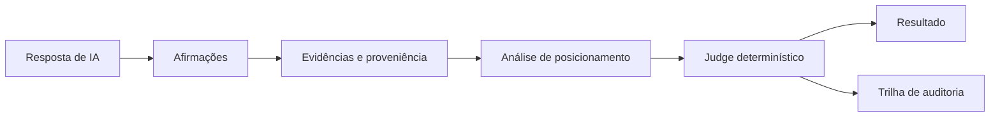

<div align="center">

<p></p>

# AYORAI ATTRACTOR

### Verificação de respostas de IA baseada em evidências

**Afirmações rastreáveis. Decisões reproduzíveis. Limites explícitos.**

[](https://github.com/Ayorinha/ayorai-opensearch/actions/workflows/ci.yml)
[](https://github.com/Ayorinha/ayorai-opensearch/actions/workflows/security.yml)
[](https://github.com/Ayorinha/ayorai-opensearch/actions/workflows/codeql.yml)
[](LICENSE)

[](https://doi.org/10.5281/zenodo.23344005)

[Visão geral](#visão-geral) · [Como funciona](#como-funciona) · [Estado atual](#estado-atual) · [Documentação](docs/INDEX.md) · [Quickstart](#quickstart)

</div>

---

## Visão geral

Sistemas generativos podem produzir respostas convincentes cujas afirmações não são sustentadas pelas fontes citadas. O **AYORAI ATTRACTOR** pesquisa e implementa uma camada de verificação que relaciona afirmações a evidências e aplica regras explícitas para produzir um resultado rastreável.

O projeto distingue análise assistida por modelos da autoridade que decide o resultado final.

> **Inteligência ≠ Autorização ≠ Execução**

## Como funciona



- **Afirmações:** unidades verificáveis extraídas da resposta.
- **Evidências:** fontes e referências que permitem inspecionar o suporte apresentado.
- **Judge determinístico:** aplica regras versionadas e é a única autoridade para o veredito final.
- **Rastreabilidade:** registra referências e hashes conforme os contratos documentados.

O Judge 2.0 define cinco vereditos: `SUPPORTED`, `PARTIALLY_SUPPORTED`, `UNVERIFIED`, `REFUTED` e `CONFLICTING`.

## Princípios de engenharia

- **Determinismo:** regras explícitas e verificações reproduzíveis.
- **Auditabilidade:** evidências e decisões podem ser inspecionadas.
- **Segurança:** riscos e limites são documentados e testados; não se presume imunidade a ataques.
- **Integridade:** hashes SHA-256 identificam conteúdo conforme semânticas documentadas; não provam que uma afirmação é verdadeira.
- **Transparência:** resultados, limitações e estado de implementação são apresentados sem transformar propostas em funcionalidades concluídas.

## Estado atual

O ATTRACTOR é uma **implementação de referência de pesquisa e engenharia**. Não deve ser interpretado como sistema certificado ou como garantia universal de correção factual.

- O contrato do Judge 2.0 e seus testes estão no repositório.
- Os resultados publicados de Golden v0 e Golden v0.1 são evidências históricas de desenvolvimento, baseadas em dados sintéticos em inglês.
- **Ainda não há resultado de benchmark em português.** O protocolo RGC está em desenvolvimento e não está congelado.
- O log de auditoria verificável completo não está implementado nem implantado.

Consulte o [estado técnico atual](docs/STATUS.md) antes de reutilizar métricas ou descrever capacidades do projeto.

## Documentação

| Quero entender… | Consulte |
|---|---|
| Por onde começar e qual documento ler | [Índice da documentação](docs/INDEX.md) |
| Instalação, execução e testes | [Guia passo a passo](docs/GUIA-PASSO-A-PASSO.md) |
| Estado, entregas e limitações atuais | [Status técnico](docs/STATUS.md) |
| Arquitetura, contratos e evidências de implementação | [Matriz de rastreabilidade](docs/TRACEABILITY-MASTER.md) · [ADRs](docs/adr/README.md) |
| Decisões de arquitetura | [Registros de decisão (ADRs)](docs/adr/README.md) |
| Método e resultados de avaliação | [Documentação de avaliação](docs/eval/) |
| Riscos e limites de segurança | [Modelo de ameaças](docs/THREAT-MODEL.md) |
| Rastreabilidade de requisitos e evidências | [Matriz de rastreabilidade](docs/TRACEABILITY-MASTER.md) |
| Considerações regulatórias brasileiras | [Conformidade no Brasil](docs/CONFORMIDADE-BRASIL.md) |
| Autoria e citação acadêmica | [Autoria](docs/AUTHORSHIP.md) · [CITATION.cff](CITATION.cff) |

## Quickstart

Requer Python 3.11, 3.12 ou 3.13.

```bash
git clone https://github.com/Ayorinha/ayorai-opensearch.git
cd ayorai-opensearch
python -m venv .venv
source .venv/bin/activate
pip install -e ".[dev]"
pytest
ruff check .
mypy src/ayorai_attractor
```

Para executar a reprodução documentada, consulte o guia e use `make reproduce` após a instalação das dependências indicadas.

## Escopo e responsabilidade

O ATTRACTOR apoia a verificação baseada em evidências. Não substitui revisão humana, não constitui aconselhamento jurídico e não demonstra, por si só, conformidade regulatória, generalização para produção ou detecção de toda alucinação. A autoridade do resultado final permanece no Judge determinístico; modelos não autorizam nem emitem o veredito final.

## Versões e citação

- Release v0.5.0: [Zenodo DOI 10.5281/zenodo.23344005](https://doi.org/10.5281/zenodo.23344005)
- DOI conceitual (todas as versões): [10.5281/zenodo.23125082](https://doi.org/10.5281/zenodo.23125082)
- Licença: [Apache-2.0](LICENSE)
- Direção técnica e autoria: Anderson Leon Ayora

---

<div align="center">

**AYORAI ATTRACTOR** · Evidência antes de conclusão.

</div>
