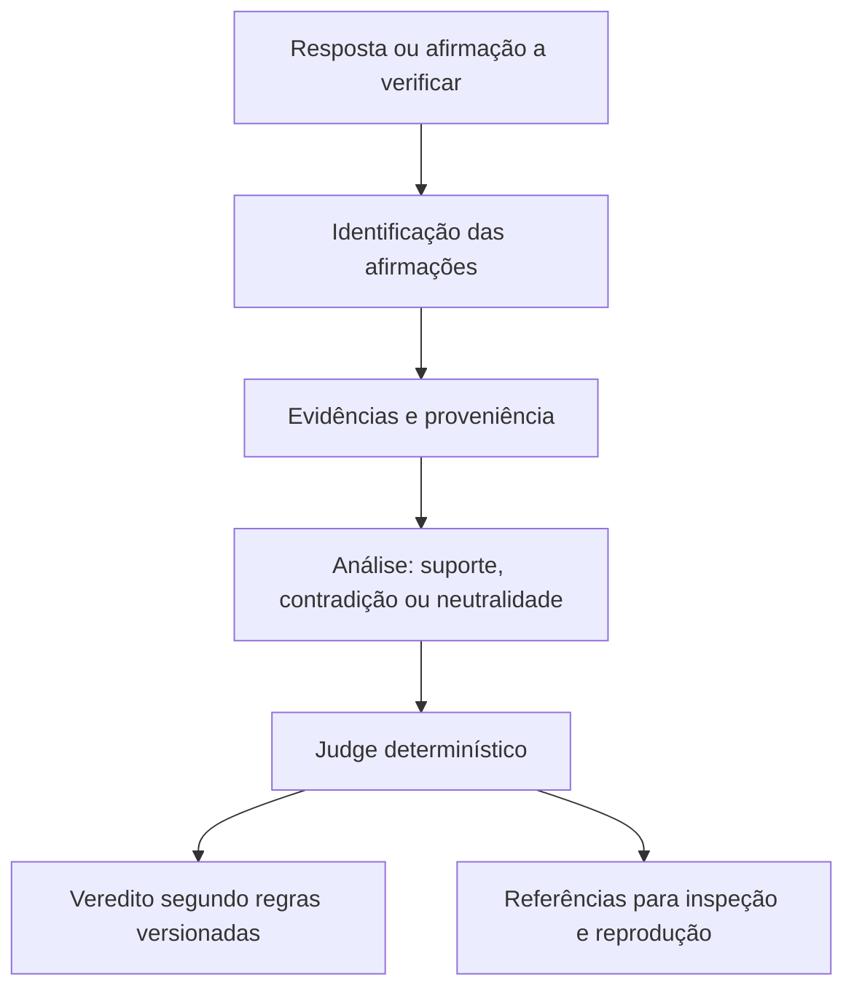

<div align="center">

<p></p>

# AYORAI ATTRACTOR

### Auditoria técnica de respostas de inteligência artificial baseada em evidências

**Da afirmação à evidência. Da evidência a um resultado verificável.**

[](https://github.com/Ayorinha/ayorai-opensearch/actions/workflows/ci.yml)
[](https://github.com/Ayorinha/ayorai-opensearch/actions/workflows/security.yml)
[](https://github.com/Ayorinha/ayorai-opensearch/actions/workflows/codeql.yml)
[](LICENSE)

[](https://doi.org/10.5281/zenodo.23344005)

[Entenda o projeto](#o-que-é) · [Como funciona](#como-funciona) · [Estado e limites](#o-que-está-comprovado-hoje) · [Documentação](docs/INDEX.md) · [Instalação](#começar)

</div>

---

## O que é

O **AYORAI ATTRACTOR** é um projeto open source de engenharia para verificar respostas de inteligência artificial no nível de cada afirmação. Seu objetivo é tornar mais fácil examinar **o que foi afirmado, quais evidências foram usadas, como elas se relacionam com a afirmação e por que determinada classificação foi emitida**.

O problema que ele aborda é concreto: uma resposta pode parecer convincente e citar uma fonte sem que essa fonte sustente o que foi dito. Em contextos que exigem responsabilidade, não basta receber uma resposta fluente; é preciso poder inspecionar a relação entre afirmação e evidência.

O ATTRACTOR desenvolve uma abordagem estruturada para essa verificação. Ele não promete eliminar todas as alucinações nem provar que uma fonte externa é verdadeira.

## Como funciona



1. **Delimitar a afirmação:** definir exatamente o que está sendo verificado.
2. **Relacionar evidências:** identificar fontes e trechos relevantes, preservando referências de proveniência disponíveis.
3. **Analisar a relação:** classificar se a evidência apoia, contradiz ou não esclarece a afirmação.
4. **Aplicar o Judge:** regras determinísticas versionadas selecionam o veredito final.
5. **Inspecionar e reproduzir:** consultar os artefatos e testes correspondentes para entender o resultado dentro dos limites definidos.

### A separação fundamental

> **Inteligência ≠ Autorização ≠ Execução**

Modelos podem auxiliar a análise. **Não são a autoridade do veredito final.** O Judge determinístico aplica o contrato explícito do sistema. A aplicação que consome o resultado também não deve transformar uma sugestão de modelo em decisão factual sem passar pelas regras previstas.

Os cinco vereditos do Judge 2.0 são: `SUPPORTED`, `PARTIALLY_SUPPORTED`, `UNVERIFIED`, `REFUTED` e `CONFLICTING`. A semântica completa está no [contrato e na rastreabilidade do Judge 2.0](docs/judge2/TRACEABILITY.md).

## Por que isso importa para auditoria

O ATTRACTOR busca tornar a verificação de respostas de IA mais **inspecionável, rastreável e reproduzível**, em vez de depender apenas de uma explicação em linguagem natural.

- **Rastreabilidade:** conectar a afirmação às evidências e às referências disponíveis.
- **Regras explícitas:** manter a decisão final separada da análise assistida por modelos.
- **Reprodutibilidade:** versionar regras, conjuntos de avaliação e artefatos relevantes.
- **Verificação técnica:** usar testes automatizados, regressões e verificações de segurança.
- **Limites declarados:** distinguir resultados medidos, funcionalidades implementadas e trabalho ainda em desenvolvimento.

Esses princípios podem apoiar pesquisas e projetos que necessitam avaliar respostas geradas por IA. A adequação a um uso real depende de validação no domínio, qualidade das fontes, configuração, controles operacionais e revisão humana.

## O que está comprovado hoje

O repositório contém implementação de verificação, contrato do Judge 2.0, testes de regressão e conjuntos sintéticos de avaliação. Há resultados históricos documentados para Golden v0 e Golden v0.1, produzidos em inglês e voltados ao desenvolvimento do sistema.

**Ainda não há resultado de benchmark em português.** O protocolo RGC permanece em desenvolvimento e não está congelado. Resultados sintéticos não demonstram desempenho em produção nem generalização para documentos jurídicos brasileiros.

O projeto **não é apresentado como certificado**, não garante a detecção de toda alucinação e não comprova conformidade regulatória por si só. Hashes ajudam a verificar a integridade de artefatos; não provam a veracidade de seu conteúdo.

Para saber o estado mais recente, consulte o [Status técnico](docs/STATUS.md). Ele é a referência para entregas, verificações e limitações atuais; relatórios antigos descrevem somente a revisão e o commit a que se referem.

## Começar

Requer Python 3.11, 3.12 ou 3.13.

```bash
git clone https://github.com/Ayorinha/ayorai-opensearch.git
cd ayorai-opensearch
python -m venv .venv
source .venv/bin/activate
pip install -e ".[dev]"
pytest
```

No Windows, ative o ambiente virtual pelo mecanismo equivalente. Para avaliações opcionais que usam backends NLI, consulte o [guia de execução](docs/GUIA-PASSO-A-PASSO.md).

## Navegue pela documentação

A documentação foi organizada por finalidade para que cada leitor encontre o nível de detalhe adequado, sem transformar a página inicial em um inventário técnico.

- **Quero entender a solução:** [Visão geral da arquitetura](docs/ARCHITECTURE.md)
- **Quero instalar e executar:** [Guia passo a passo](docs/GUIA-PASSO-A-PASSO.md)
- **Quero verificar o estado real:** [Status técnico](docs/STATUS.md)
- **Quero conferir regras e decisões:** [Judge 2.0](docs/judge2/TRACEABILITY.md) · [Decisões de arquitetura](docs/adr/README.md)
- **Quero avaliar evidências, riscos e limites:** [Modelo de ameaças](docs/THREAT-MODEL.md) · [Considerações para o Brasil](docs/CONFORMIDADE-BRASIL.md)
- **Quero encontrar os documentos restantes:** [Índice completo da documentação](docs/INDEX.md)

## Projeto aberto e responsabilidade

O AYORAI ATTRACTOR é distribuído sob a licença [Apache-2.0](LICENSE). A documentação técnica e os artefatos de avaliação devem ser lidos considerando sua versão, escopo e limitações. O sistema apoia a análise; não substitui profissionais responsáveis, revisão humana, controles internos ou avaliação jurídica.

**Princípio do projeto:** toda conclusão relevante deve poder ser examinada à luz das evidências e das regras que a produziram.

<div align="center">

**AYORAI ATTRACTOR** · Evidência antes de conclusão.

</div>
