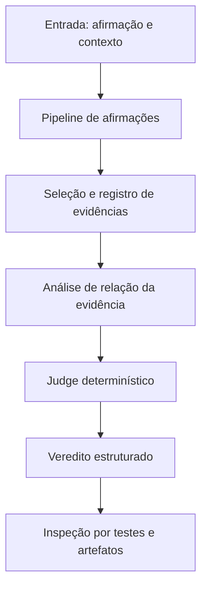

# Visão geral da arquitetura

Este documento explica o ATTRACTOR para leitores técnicos, equipes de auditoria e pessoas que precisam avaliar se a abordagem é adequada a um caso de uso. Ele apresenta o fluxo conceitual; os contratos normativos e os detalhes de implementação continuam nos arquivos técnicos específicos.

## 1. O problema que o sistema procura resolver

Uma resposta gerada por IA pode conter várias afirmações, e uma fonte citada pode sustentar apenas parte delas — ou contradizê-las. Avaliar a resposta como um único bloco esconde essas diferenças.

O ATTRACTOR trata a verificação como uma relação entre afirmações delimitadas e um conjunto de evidências. O resultado deve ser interpretado dentro desse conjunto: o sistema não prova automaticamente que a fonte é verdadeira, atual, completa ou juridicamente aplicável.

## 2. Fluxo de verificação

### Etapa 1 — Entrada e afirmações

A entrada delimita o conteúdo que será avaliado. A qualidade da verificação depende de uma afirmação clara e de um escopo definido. A arquitetura não deve tratar texto encontrado em documentos de evidência como autorização para substituir a afirmação de entrada.

### Etapa 2 — Evidências e proveniência

As evidências são relacionadas à afirmação com metadados e referências disponíveis no fluxo. Isso permite que uma pessoa examine a origem e a relação usadas na avaliação. Referência, trecho ou hash não equivalem a uma certificação de que a fonte é verdadeira.

### Etapa 3 — Análise da relação

A análise identifica se a evidência apoia, contradiz ou não permite concluir algo sobre a afirmação. Componentes assistidos por modelos podem contribuir para essa etapa, mas suas saídas não são o veredito factual final.

### Etapa 4 — Judge determinístico

O Judge aplica um contrato explícito e versionado para determinar o estado final. No Judge 2.0, os vereditos factuais são:

| Veredito | Interpretação resumida |
|---|---|
| `SUPPORTED` | As evidências avaliadas sustentam a afirmação segundo as regras. |
| `PARTIALLY_SUPPORTED` | As evidências sustentam apenas parte do conteúdo avaliado. |
| `UNVERIFIED` | As evidências disponíveis não permitem sustentar a afirmação. |
| `REFUTED` | As evidências avaliadas contradizem a afirmação. |
| `CONFLICTING` | As evidências avaliadas apresentam conflito relevante. |

A semântica normativa, os casos especiais e a ligação com testes estão no [documento de rastreabilidade do Judge 2.0](judge2/TRACEABILITY.md). A tabela acima é apenas uma introdução, não substitui o contrato.

### Etapa 5 — Inspeção e reprodução

A avaliação da implementação deve combinar código, contrato, testes, artefatos e versão exata. Resultados de um conjunto sintético devem ser apresentados como resultados daquele conjunto — não como estimativa automática de desempenho em produção.

## 3. Fronteiras de responsabilidade

O desenho separa três papéis:

- **Inteligência:** auxilia tarefas de análise de texto e de evidências.
- **Autorização do resultado:** o Judge determinístico aplica as regras que definem o veredito final.
- **Execução:** a aplicação consumidora utiliza o resultado conforme seu próprio contexto e controles.

Essa separação reduz a possibilidade de confundir uma resposta plausível de um modelo com uma decisão autorizada pelo contrato. Ela não elimina todos os riscos de software, de dados, de configuração ou de operação.

## 4. O que uma auditoria deve verificar

Para avaliar uma execução ou uma versão do ATTRACTOR, registre pelo menos:

1. versão e commit do código;
2. contrato e versão das regras do Judge;
3. identificação e origem do conjunto de evidências;
4. configuração e componentes opcionais usados;
5. testes e verificações executados;
6. resultados, falhas, abstenções e limitações observadas;
7. hashes dos artefatos relevantes, quando aplicável;
8. revisão humana e contexto de uso, quando exigidos.

O conjunto exato depende do cenário. Esta lista é uma orientação de avaliação, não uma declaração de que cada item é registrado automaticamente por toda execução.

## 5. Estado e limites conhecidos

- O projeto contém uma implementação do pipeline de verificação e do Judge 2.0, com testes de regressão.
- Golden v0 e Golden v0.1 são conjuntos sintéticos de desenvolvimento em inglês; seus resultados não devem ser tratados como validação de produção.
- Não há resultado de benchmark em português. O protocolo RGC está em desenvolvimento e não está congelado.
- O sistema não garante detectar todas as alucinações e não certifica a verdade ou a qualidade das fontes externas.
- A adoção do projeto não comprova, por si só, conformidade com a LGPD ou com qualquer outra obrigação regulatória.

Consulte [Status técnico](STATUS.md) para o estado atual. Para ameaças e controles, leia o [Modelo de ameaças](THREAT-MODEL.md). Para o contrato vinculante, use a [rastreabilidade do Judge 2.0](judge2/TRACEABILITY.md).

## 6. Documentos normativos e complementares

- [Judge 2.0 — rastreabilidade gerada a partir do contrato](judge2/TRACEABILITY.md)
- [Registros de decisão de arquitetura](adr/README.md)
- [Modelo de ameaças](THREAT-MODEL.md)
- [Guia passo a passo](GUIA-PASSO-A-PASSO.md)
- [Índice da documentação](INDEX.md)

**Regra de leitura:** esta visão geral explica a arquitetura; não substitui contratos normativos, código, testes nem relatórios de avaliação.
