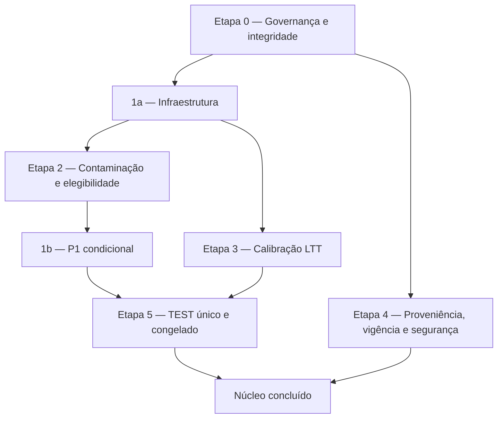

# Estado do núcleo — AYORAI ATTRACTOR

**Natureza:** documento de estado (Etapa 0 — integridade e governança). Não cria decisões, não altera regras e não substitui `docs/STATUS.md`; consolida o que o núcleo já demonstrou, o que falta e o que depende do mantenedor.  
**Referência:** `main` em `22c58088e2a8b58f9fa1879cc2ac81516ebfc6be` (merge da #508), 2026-11-08.  
**Autoria:** ANDERSON AYORA. Decisões: Anderson Leon Ayora, mantenedor.  
**Classificação:** FATO VERIFICADO (com link ou hash) / INFERÊNCIA / HIPÓTESE / PROPOSTA.

## 1. O que é o núcleo

O núcleo é a parte genérica do AYORAI, independente de cliente ou domínio: verificar se cada afirmação é sustentada por um documento, decidir de forma determinística, abster-se quando não há garantia e registrar evidência reproduzível. Aplicações de domínio (por exemplo, um piloto institucional) usam o núcleo por meio de módulos próprios e **não** fazem parte desta definição.

## 2. Plano consolidado (revisão independente concluída em 2026-11-08)

Três resultados distintos, nunca confundidos: **implementação concluída** (código e protocolos fechados), **validação concluída** (resultados reproduzíveis, inclusive negativos ou inconclusivos) e **confirmação independente concluída** (TEST único, congelado e autorizado). Se todas as etapas fecharem com alguma garantia ainda condicionada, o termo é **"núcleo concluído com limitações documentadas"**. Resultado inconclusivo não é fracasso: é o projeto respeitando os próprios critérios.

## 3. Situação de cada etapa

| Etapa | Situação em 2026-11-08 | Critério de pronto (resumo) |
|---|---|---|
| 0. Governança e integridade | Em andamento (este documento) | Escopo e regras congelados; inventário de evidências; decisões pendentes listadas; limites registrados |
| 1a. Infraestrutura | Parcial: cache v2 (código) mesclado na #508; pré-registros (#504) e código da P1 (#505) em revisão/merge; caminho de execução do cache v2 depende de decisão (seção 6) | Merges feitos; cache v2 construído com replay idêntico; regra de coorte não estimável fixada por emenda |
| 2. Contaminação e elegibilidade | Não iniciada; DEC-026 proposta (#509); hoje 0/55 células elegíveis | Protocolo empírico pré-registrado e executado (só DEV, agregado); decisão sobre exposição de seleção do FactCG |
| 1b. P1 condicional | Bloqueada pela Etapa 2 e pela regra de coorte | Uma execução, rótulo "confirmação condicional em holdout parcialmente usado", resultado publicado qualquer que seja |
| 3. Calibração LTT | Esboço de pré-registro (#504) | Pré-registro aprovado; família 2 candidatos × 11 coortes; uma afirmação por documento; certificação executada e publicada |
| 4. Proveniência, vigência e segurança | Não iniciada; escopo mínimo a propor | Fonte e hash de cada documento citado, vigência e versão; taxa de falha medida em conjunto adversarial pequeno |
| 5. TEST único | Não iniciado | Tudo congelado; execução única autorizada; publicação positiva ou negativa |

## 4. Inventário de evidências existentes

| Evidência | Identificação verificável | O que demonstra | Classificação |
|---|---|---|---|
| Release v0.7.0 | DOI [10.5281/zenodo.24045951](https://doi.org/10.5281/zenodo.24045951); tag `v0.7.0` | Primeiro resultado DEV da Calibration V2 (FactCG 74,68% BA, DEV) | FATO VERIFICADO |
| Calibration V2, DEV completo | `reports/benchmarks/2026-11-07-dev-calibration-v2/`; run 42418593837; `report_sha256` d4117418… | Pipeline protegido reproduzível sobre 30.420 casos DEV | FATO VERIFICADO |
| Emenda 2 (LTT, limiares inelegíveis) | `reports/benchmarks/2026-11-08-phase1b-amendment-2-exploratory/`; run 42436331559; `report_sha256` 43b45a75… | 4/11 coortes certificadas (risco ≤ 10%, FactCG); exploratório; sem a restrição de uma afirmação por documento | FATO VERIFICADO; limitação em discussão |
| Cache de scores v1 | run 42477997402 (re-agregação); manifesto `deb3ef38…` | Cache cifrado reproduz o relatório da Emenda 2 bit a bit | FATO VERIFICADO |
| Replays do cache | runs 42480384607 e 42483517733 | Calibration V2 recalculada a partir do cache é idêntica (`replay_matches_source = true`) | FATO VERIFICADO |
| E3 exploratório | `reports/benchmarks/2026-11-08-e3-exploratory/`; run 42485634513; `report_sha256` 43dcd7ef… | E3b-01 0,7611 vs FactCG 0,7475 em DEV-A; exploratório; não comparável ao leaderboard | FATO VERIFICADO (exploratório) |
| Snapshot do leaderboard | `docs/benchmarks/snapshots/LLM-AGGREFACT-LEADERBOARD-2026-11-07.md` (sha256 f1fd7c86…) | Referências externas: topo 79,5; Bespoke-7B 77,4; FactCG 75,6 | FATO VERIFICADO na data |
| Ledger de contaminação A4 | `docs/benchmarks/CONTAMINATION-LEDGER-v0.8.md` (commit `dfce6851…`) | 55 células examinadas com fontes primárias; 0/55 liberadas pelo critério atual | FATO VERIFICADO |
| Pin do DEV | `configs/benchmarks/llm-aggrefact-dev-pin.json` (sha256 do arquivo `ca9a5bda…`) | DEV fixado por revisão e hash; termos: só avaliação, sem fine-tuning | FATO VERIFICADO |

## 5. Limites do que o núcleo demonstrou até aqui

- Nenhum resultado confirmatório de acurácia existe. Todo resultado do ensemble é exploratório e restrito ao DEV-A.
- Nenhuma comparação com o leaderboard é válida antes do TEST único (o leaderboard usa TEST e 11 coortes).
- As garantias LTT publicadas valem só para dados intercambiáveis com cada coorte do DEV e ainda não incorporam a independência entre afirmações do mesmo documento.
- O DEV-B é um holdout parcialmente usado (decisão do mantenedor: opção A).
- O benchmark RGC em português permanece **[PROPOSTO]**, não congelado; não há resultado RGC publicado.
- Proveniência, vigência documental e robustez a injeção em documentos ainda não foram medidas.
- O projeto não é certificado, não detecta toda alucinação e não comprova conformidade regulatória por si só. Hashes verificam integridade de artefatos, não a veracidade do conteúdo.

## 6. Decisões que dependem do mantenedor

1. **Caminho de execução do cache v2:** a revisão independente entende que a regra atual proíbe *adicionar* workflows de disparo manual; o revisor técnico entende que ela proíbe *disparar* sem autorização. Sem um workflow protegido, o cache v2 não pode ser construído. Decidir se uma PR separada com esse workflow (e a trava atômica da P1) pode ser aberta.
2. **DEC-026** (elegibilidade por estados verificáveis): aprovar, ajustar ou rejeitar.
3. **Exposição de seleção do FactCG** (limiar ajustado no validation do LLM-AggreFact): bloqueia ou não células para uso confirmatório.
4. **Regra objetiva de coorte não estimável** (`NON_ESTIMABLE_RULE`), por emenda datada após as contagens do cache v2 e antes de qualquer cálculo em DEV-B.
5. **Errata da Emenda 2** sobre independência entre afirmações (sem reescrever o histórico).
6. **Aprovação** dos pré-registros da P1 e da etapa 3, quando os gates estiverem fechados.
7. **PRs sobrepostas ou em espera:** #506 (matriz v0.9 derivada do ledger) trata do mesmo tema da #509 (DEC-026 e reconciliação); #507 (protocolo MiniCheck-Flan-T5); #500 (índice documental). Decidir consolidar, manter ou fechar.
8. **Escopo mínimo da Etapa 4** e orçamento de GPU para membros LLM (fora do núcleo mínimo).

## 7. Regras congeladas durante a conclusão do núcleo

Judge 2.0, Golden, hashes, thresholds, protocolo RGC e ResponsePolicy permanecem intocados; TEST único e congelado; nenhum dado por instância em público; nenhum número inventado; nenhum workflow disparado nem ambiente aprovado sem autorização expressa; DEC-024 opção B (sem treino com dados do benchmark); DEC-026 permanece proposta até decisão.
