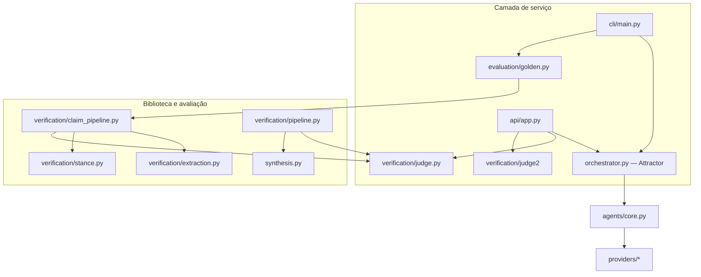

Estado: Atual · Referência: main @ 418a82f · Atualizado: 2026-10-18
Fontes de verdade: `src/ayorai_attractor/api/app.py`, `src/ayorai_attractor/cli/main.py`, `src/ayorai_attractor/orchestrator.py`, `src/ayorai_attractor/agents/core.py`, `src/ayorai_attractor/agents/roles.py`, `src/ayorai_attractor/verification/claim_pipeline.py`, `src/ayorai_attractor/verification/pipeline.py`, `src/ayorai_attractor/synthesis.py`, `src/ayorai_attractor/evaluation/golden.py`.

# 02 — Arquitetura

## Propósito

Este capítulo separa os entrypoints de serviço dos componentes de biblioteca e distingue papéis declarados como metadados de agentes que são efetivamente instanciados pelo orquestrador. O diagrama representa os imports e chamadas identificados no código, não uma arquitetura-alvo.

## Como funciona

### Camada de serviço: API e CLI

- `src/ayorai_attractor/api/app.py` define a API FastAPI. As rotas operacionais usam `Attractor`; `POST /v1/verify` despacha separadamente para o Judge r1-a ou para o Judge 2 r2-a.
- `src/ayorai_attractor/cli/main.py` define a CLI Typer. O comando `search` chama `Attractor.run()`; o comando `eval` chama `evaluate_golden_v0()`.
- `src/ayorai_attractor/orchestrator.py` implementa `Attractor`, seleciona os agentes disponíveis, chama seus métodos `run()` e agrega resposta, evidências e falhas.

### Camada de biblioteca e avaliação

- `verification/extraction.py` define contratos e implementações para decompor respostas em afirmações e representar documentos recuperados.
- `verification/stance.py` fornece detectores de stance usados pelo pipeline de afirmações da avaliação.
- `verification/claim_pipeline.py` compõe extração/normalização, evidências, stance e Judge no fluxo utilizado pela avaliação Golden. `evaluation/golden.py` importa esse pipeline para avaliar fixtures locais.
- `verification/pipeline.py` é outro pipeline composto: chama o Judge e `synthesis.py`, que verifica se cada afirmação de saída tem IDs de evidência conhecidos. Este módulo é uma biblioteca separada; não é importado diretamente pelos entrypoints `api/app.py` ou `cli/main.py`.
- A rota pública `POST /v1/verify` não chama `verification/pipeline.py` nem `verification/claim_pipeline.py`: ela recebe os contratos de verificação já estruturados. A CLI `eval`, por outro lado, chama a avaliação Golden, que usa `verification/claim_pipeline.py`.

### Diagrama de imports e chamadas

O diagrama destaca caminhos de importação/call relevantes para explicar os limites. Não representa todos os módulos auxiliares importados por cada componente.

### Agentes implementados e metadados de papéis

`src/ayorai_attractor/agents/core.py` implementa `PlannerAgent`, `ResearchAgent`, `CriticAgent`, `FactCheckerAgent` e `JudgeAgent`. No código atual, `PlannerAgent`, `CriticAgent`, `FactCheckerAgent` e `JudgeAgent` devolvem strings fixas construídas no próprio código; não consultam provedores. `ResearchAgent` é o agente que chama `context.search_provider.execute()` e `context.provider.execute()`.

`src/ayorai_attractor/orchestrator.py` registra esses cinco tipos em `IMPLEMENTED_AGENTS`. Separadamente, `src/ayorai_attractor/agents/roles.py` declara 26 itens em `INITIAL_ROLES`, cada um com `id`, `name` e `capability`. Esses 26 itens são metadados de papéis; não significam que existam 26 classes de agente implementadas ou selecionáveis pelo orquestrador.

### Módulos fora dos caminhos de importação da API e da CLI

A verificação parte dos imports em `src/ayorai_attractor/api/app.py` e `src/ayorai_attractor/cli/main.py`, seguindo os caminhos de operação por `orchestrator.py`, `agents/core.py` e `evaluation/golden.py`. Os seguintes módulos foram confirmados como fora desses caminhos de importação da API e da CLI:

- `arena`
- `council`
- `durable`
- `gepa`
- `governance`
- `job_executor`
- `job_store`
- `mcp_gateway`
- `plugins`
- `tenancy`
- `synthesis`
- `redteam`
- `metrics`
- `optimization`
- `evidence.graph`
- `replay_store`
- `verification.pipeline`
- `verification.translation`
- `verification.nli`
- `brain`
- `auditlog`

Essa lista descreve apenas os caminhos desses entrypoints; não afirma que os módulos não existam, não sejam testados ou não possam ser usados por scripts, testes ou outros consumidores da biblioteca. Em particular, `synthesis` é importado por `verification/pipeline.py`, mas esse pipeline composto não integra o caminho de imports da API nem da CLI descrito acima.

## Contratos e parâmetros

Os contratos HTTP e seus campos estão definidos em `api/app.py` e `verification/api_models.py`; os parâmetros da CLI estão definidos em `cli/main.py`. A separação arquitetural não altera esses contratos: a API recebe estruturas preparadas, a CLI `search` chama o orquestrador, e a CLI `eval` executa o fluxo de avaliação Golden.

## Limites conhecidos

- Os nomes em `INITIAL_ROLES` não devem ser interpretados como inventário de agentes executáveis.
- As strings fixas emitidas por quatro classes não são avaliações semânticas independentes nem resultados de modelos.
- `verification/pipeline.py` e `verification/claim_pipeline.py` são módulos distintos, com funções e caminhos de importação distintos.
- A presença de um módulo no pacote não demonstra que ele esteja integrado à API ou à CLI.

## Evidências

- Entrypoints: `src/ayorai_attractor/api/app.py` e `src/ayorai_attractor/cli/main.py`.
- Orquestração e conjunto de agentes selecionáveis: `src/ayorai_attractor/orchestrator.py`.
- Implementações dos agentes: `src/ayorai_attractor/agents/core.py`.
- Papéis declarados: `src/ayorai_attractor/agents/roles.py`.
- Pipeline usado pela avaliação: `src/ayorai_attractor/verification/claim_pipeline.py` e `src/ayorai_attractor/evaluation/golden.py`.
- Pipeline composto e síntese: `src/ayorai_attractor/verification/pipeline.py` e `src/ayorai_attractor/synthesis.py`.

## Ver também

- [Visão geral](01-visao-geral.md)
- [Módulos experimentais](../EXPERIMENTAL-MODULES.md)
- [Pipeline de verificação composta](../architecture/VERIFICATION-PIPELINE.md)
